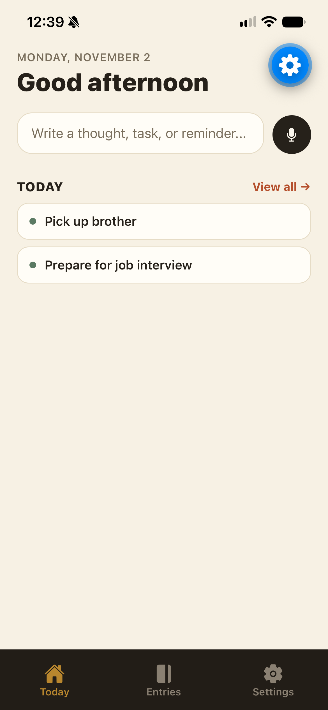
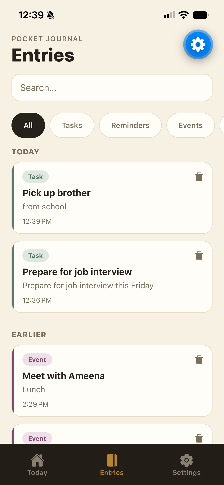
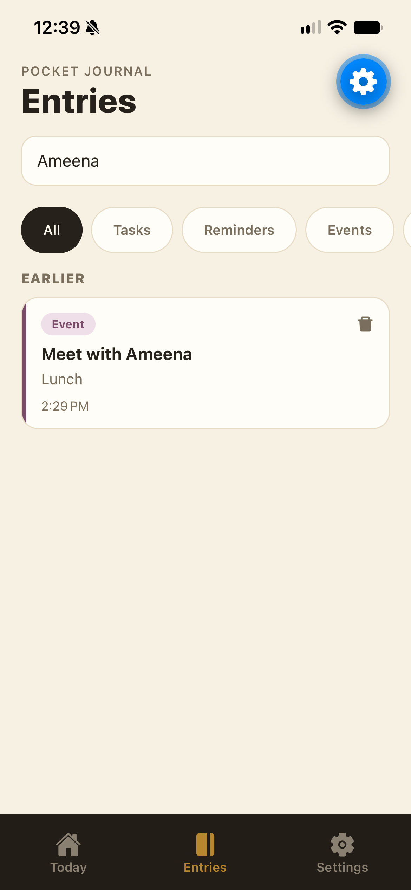

# Pocket Journal

A mobile journaling and productivity app that turns everyday thoughts into organized notes, tasks, reminders, and events.

Type an entry or record a voice message. Pocket Journal uses Google Gemini to identify useful details such as dates, categories, and priorities, then saves the entry for later.





## Features

- Text and press-and-hold voice entries
- Audio transcription using Google Gemini
- AI classification into notes, tasks, reminders, and events
- Automatic extraction of titles, dates, priorities, and keywords
- Search across entry text, titles, descriptions, and keywords
- Filtering by entry type
- Editing and deleting saved entries
- Local reminder notifications
- Supabase authentication and user-specific entries

## Tech Stack

| Layer           | Technology                    |
| --------------- | ----------------------------- |
| Mobile app      | React Native, Expo            |
| Navigation      | Expo Router                   |
| Backend         | Node.js, Express              |
| Database        | PostgreSQL hosted on Supabase |
| Authentication  | Supabase Auth                 |
| AI processing   | Google Gemini                 |
| Audio recording | Expo Audio                    |
| Notifications   | Expo Notifications            |

## How It Works

1. The user signs in through Supabase Auth.
2. The app sends requests to the Express backend with the user's access token.
3. For voice entries, the backend sends the recording to Gemini for transcription.
4. Gemini converts the entry text into structured JSON.
5. The backend saves the entry in PostgreSQL, associated with the authenticated user.
6. The app displays the entry and schedules a local notification when applicable.

Entry requests are authenticated, and database queries restrict access to the current user's entries.

## Project Structure

- `app/` — screens and navigation
- `components/` — reusable interface components
- `utils/` — authentication, notifications, and theme utilities
- `backend/server.js` — API routes, authentication middleware, and Gemini integration
- `backend/db.js` — PostgreSQL connection
- `assets/` — app icons and images

## Development Setup

### Requirements

- Node.js and npm
- A Supabase project with authentication enabled
- A PostgreSQL database with the application's `entries` table
- A Gemini API key
- An Android or iOS development environment, or an installed Expo development build

### Clone the repository

```bash
git clone https://github.com/Tenthship/PocketJournal.git
cd PocketJournal
```

### Backend

Install dependencies:

```bash
cd backend
npm install
```

Create `backend/.env`:

```env
DATABASE_URL=your_postgresql_connection_string
GEMINI_API_KEY=your_gemini_api_key
SUPABASE_URL=your_supabase_project_url
SUPABASE_ANON_KEY=your_supabase_anon_key
PORT=3000
```

Start the server from the `backend` directory:

```bash
npm start
```

The backend listens on port 3000 by default.

### Database

The backend expects an existing `entries` table. Database creation
scripts and migrations are not yet included in this repository, so
installing dependencies alone does not complete database setup.

### Mobile app

In a second terminal, install dependencies from the project root:

```bash
npm install
```

Update the Supabase configuration in `utils/supabase.js` to use your
own project.

The frontend currently references a hosted backend URL. To use your
own backend, replace occurrences of
`https://pocketjournal.onrender.com` in the frontend source.

When testing on a physical phone, use your computer's local network
IP address rather than `localhost`. The phone must be able to reach
the backend.

For local native development:

```bash
npx expo run:android
```

Or, on macOS with Xcode:

```bash
npx expo run:ios
```

If a compatible development build is already installed:

```bash
npx expo start --dev-client
```

Allow microphone and notification permissions when prompted.
Use a development build when testing native functionality.

## API

All endpoints except `/` require a valid Supabase Bearer token.

| Method | Endpoint       | Purpose                                |
| ------ | -------------- | -------------------------------------- |
| GET    | `/`            | Basic server response                  |
| GET    | `/entries`     | Retrieve the current user's entries    |
| POST   | `/entries`     | Process and save text using AI         |
| PUT    | `/entries/:id` | Update an entry's text                 |
| DELETE | `/entries/:id` | Delete an entry                        |
| POST   | `/upload`      | Transcribe an uploaded audio recording |

## Current Limitations

- Database setup requires manual configuration.
- Frontend service configuration is currently defined in source files.
- Search uses text matching rather than semantic AI search.
- Editing text does not rerun AI classification.
- AI-generated dates and classifications may need review.
